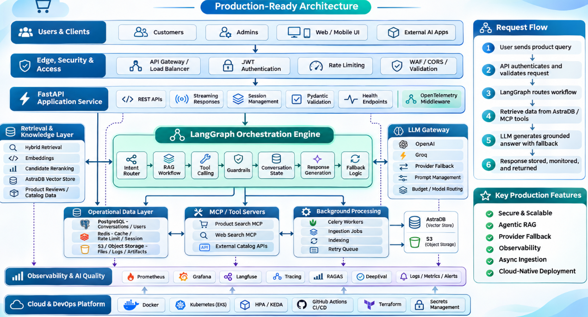

# Enterprise E-Commerce Agentic AI Assistant — V3

A production-oriented **complete source-code reference** based on the earlier `ecomm-enterprise-v2` scaffold and the original project's known FastAPI, LangGraph, AstraDB, MCP and product-recommendation design. The source is here, but **production readiness is not certified**. See `docs/VALIDATION.md` for exact verified vs unverified capabilities.

## Included, with source paths
- API, JWT/JWKS, limits, persistent messages and conversation ownership: `app/api`, `app/core`, `app/infra`
- LangGraph answer pipeline and grounded citations: `app/services/ai_graph.py`
- OpenAI + Groq fallback, timeout, circuit breaker: `app/services/llm_gateway.py`
- AstraDB semantic search, local lexical fusion/reranking code: `app/services/catalog.py`, `app/services/hybrid_search.py`. **Native Astra BM25/full hybrid is not wired**; local lexical fusion is useful for sample corpora, not production-quality large-corpus BM25.
- Guardrails for size/secrets and untrusted retrieved text: `app/services/guardrails.py` (defense-in-depth, not a general injection guarantee)
- Celery Redis ingestion worker: `app/workers/tasks.py`
- RAGAS/DeepEval import adapters and deterministic offline gates: `evaluation/`
- OpenTelemetry, optional Langfuse callbacks, Prometheus/Grafana: `app/services/observability.py`, `observability/`
- Local Docker, EKS/HPA/KEDA manifests and AWS Terraform: `docker-compose.yml`, `deploy/`, `infra/terraform/`
- GitHub Actions, pytest, security checks, load-test Locust scenarios: `.github/`, `tests/`, `loadtests/`
- Legacy original scraper/workflow/data import script: `scripts/import_original.py`. **Original GitHub files are not embedded**: remote repository download failed in this environment. Import them from a local clone before claiming full feature parity.

## Quick start (demo mode)
```bash
cp .env.example .env
docker compose up --build -d
curl http://localhost:8000/api/v1/health/ready
curl -X POST http://localhost:8000/api/v1/chat -H 'Content-Type: application/json' -d '{"message":"Which phone has a good battery?"}'
```
Dev mode uses a sample catalog, does not require model API keys. For local use only; do not expose dev-auth to the Internet. The application is API-first; no production-ready React/Next.js web frontend is supplied.

## Streamlit UI (no Docker, PostgreSQL, or Redis)
```powershell
py -m venv .venv
.\.venv\Scripts\Activate.ps1
python -m pip install -e .
python -m streamlit run streamlit_app.py
```
Open `http://localhost:8501`. Catalog search and deterministic answers work without an API key. For generated answers, enter an OpenAI or Groq key in the sidebar; the UI keeps it only in the current Streamlit session.

## Bring original legacy project into the tree
```bash
git clone https://github.com/sunnysavita10/ecomm-prod-assistant.git ../ecomm-prod-assistant
python scripts/import_original.py --original ../ecomm-prod-assistant
CATALOG_CSV=data/product_reviews.csv python -m app.infra.ingest
```
The import copies existing `prod_assistant`, scraper, HTML/static assets and data under `legacy/` without deleting V3 files. Review duplicated/legacy dependencies, data licensing, model embedding dimensions and live integration compatibility before promoting legacy features.

## Production configuration
Set `ENVIRONMENT=production`, `AUTH_MODE=jwks`, `RETRIEVAL_MODE=astra`, JWT issuer/audience/JWKS URL, OpenAI embedding credentials, vector collection and infrastructure connection strings. Set `GROQ_API_KEY` optionally for a secondary generation provider. Production uses identity provider JWTs, not dev auth. Run migration with reviewed schema migration process, not `create_all`. Refer to `infra/terraform/README.md` and `deploy/k8/README.md`. Configure model API budgets and data privacy before enabling external evaluations/tracing.

## Current caveats
- Original repository was not cloned into this artifact; use the provided import script. No claim of byte-for-byte feature parity.
- API/frontend, model integrations, EKS and Terraform are not proven by end-to-end or AWS deployment tests.
- This reference's vector search is semantic; BM25 on AstraDB is a pending integration. The deterministic lexical/RRF helper is functional but insufficient for true enterprise cross-corpus hybrid search.
- Evaluation CI currently runs deterministic/unit tests; external RAGAS/DeepEval live scoring requires model API credentials, validated datasets and explicit threshold configuration.
- Langfuse callback integration is optional (`pip install -e '.[observability]'`); dashboards are provided for Grafana, not a provisioned Langfuse instance.
- KEDA Redis requires correctly secured `rediss://`/auth in managed environments. Deployment templates require platform review.

This ZIP is a substantial implementation scaffold, not a verified turnkey production deployment.


